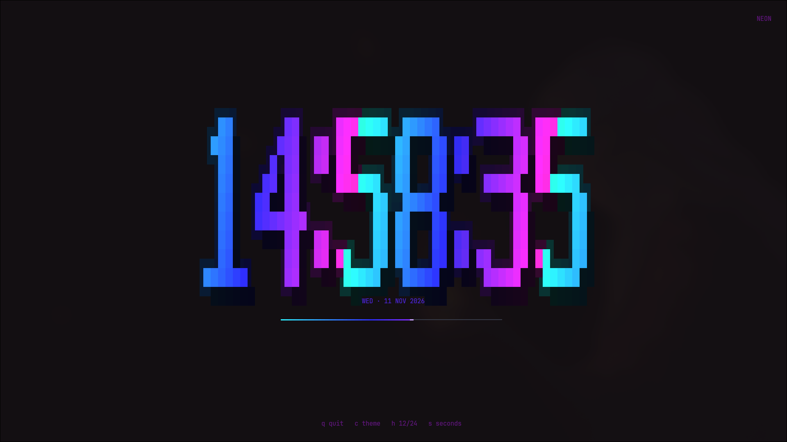
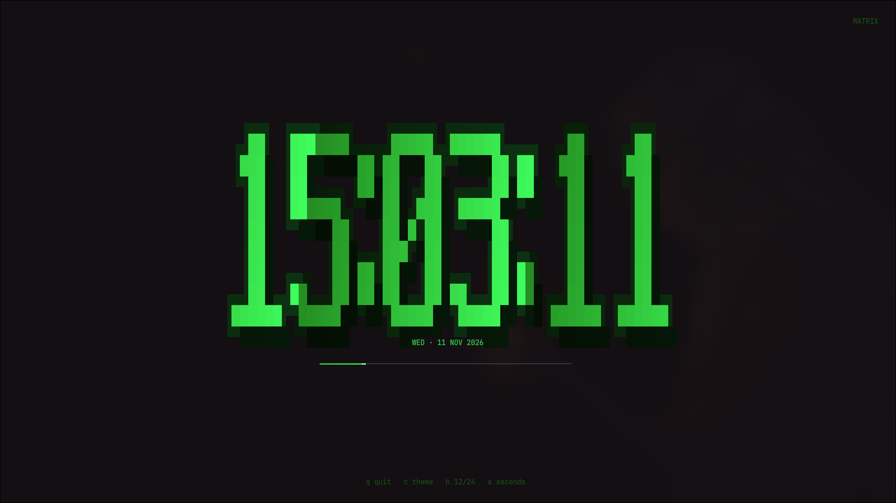
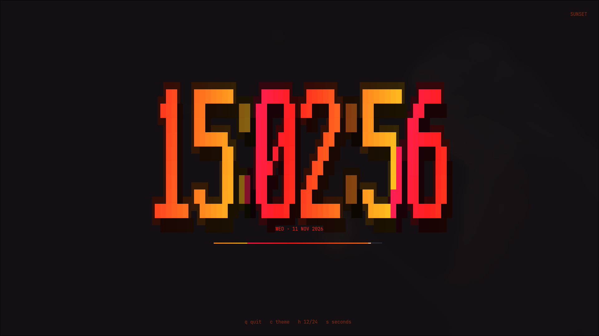

# scs

A very cool TUI clock with a large pixel font, nine color themes, and a live minute progress bar.



| Matrix | Sunset |
|:---:|:---:|
|  |  |

## Features

- Large 7x9 pixel font with a 5x7 fallback
- Nine themes: neon, sunset, matrix, ice, candy, fire, ocean, mono, rainbow
- Date, minute progress bar, 12/24-hour time, and optional seconds
- Animated glow and diff rendering
- Static mode for scripts and screenshots
- Optional config file and man page

## Install

Arch-based systems:

```sh
sudo pacman -U scs-0.2.0-1-x86_64.pkg.tar.zst
```

Build from source with makepkg:

```sh
makepkg -si
```

Or build with Cargo:

```sh
cargo build --release
./target/release/scs
```

## Usage

```text
scs [OPTIONS]
```

Keys:

- `q` or `Esc`: quit
- `c`: cycle theme
- `h`: toggle 12/24-hour time
- `s`: toggle seconds
- `r`: reset options

Options:

- `--static`: print one frame and exit
- `--config <PATH>`: read a config file
- `--theme <NAME>`: select a theme
- `--12h` / `--24h`: use 12/24-hour time
- `--seconds` / `--no-seconds`: show/hide seconds
- `--fps <FPS>`: animation rate, clamped to 10-144
- `--color` / `--no-color`: enable/disable ANSI colors

After installing, see `man scs` for the full manual.

## Configuration

`scs` reads `~/.config/scs/config.toml` by default, or the path passed with `--config`. Command-line options override the file.

```toml
theme = "matrix"
twelve_hour = false
show_seconds = true
fps = 30
color = true
```

Supported keys: `theme`, `twelve_hour`, `show_seconds`, `fps`, and `color`.

## License

MIT
